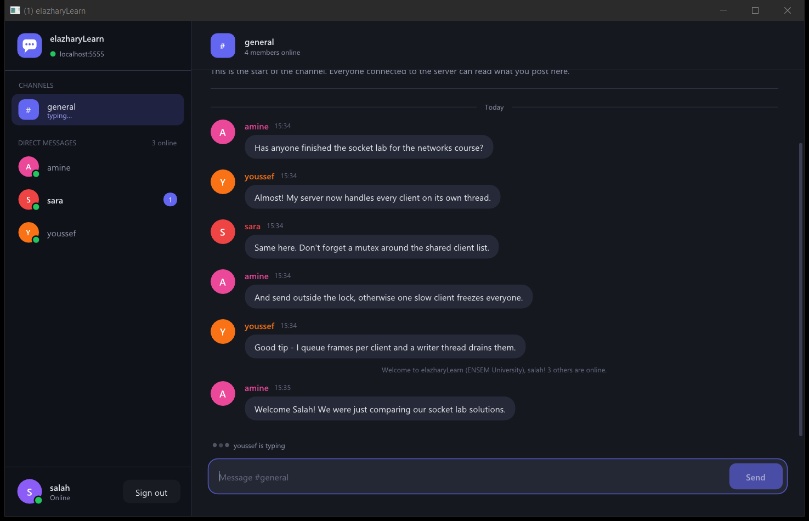
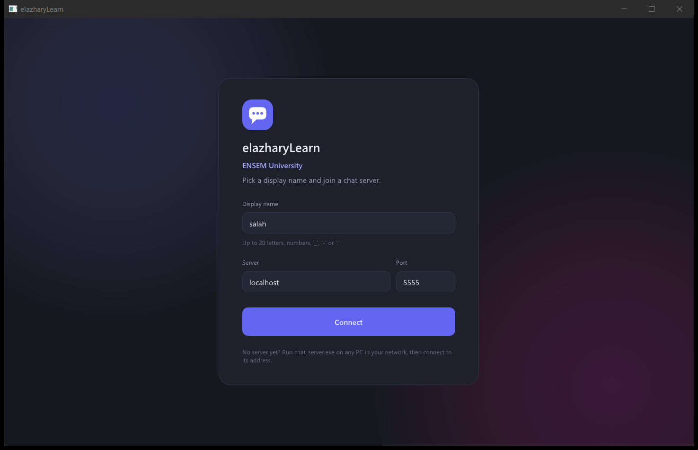
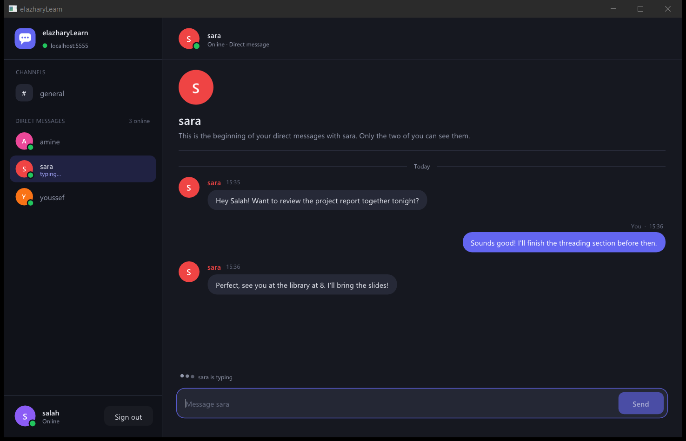
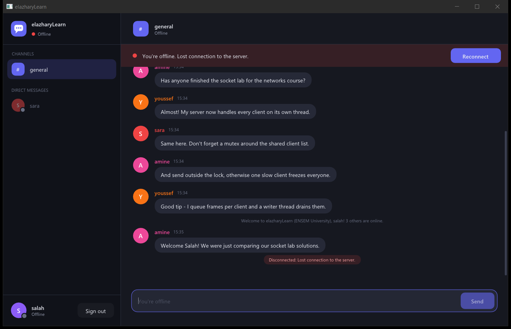
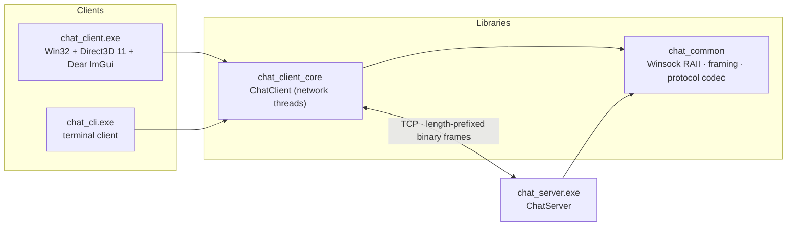
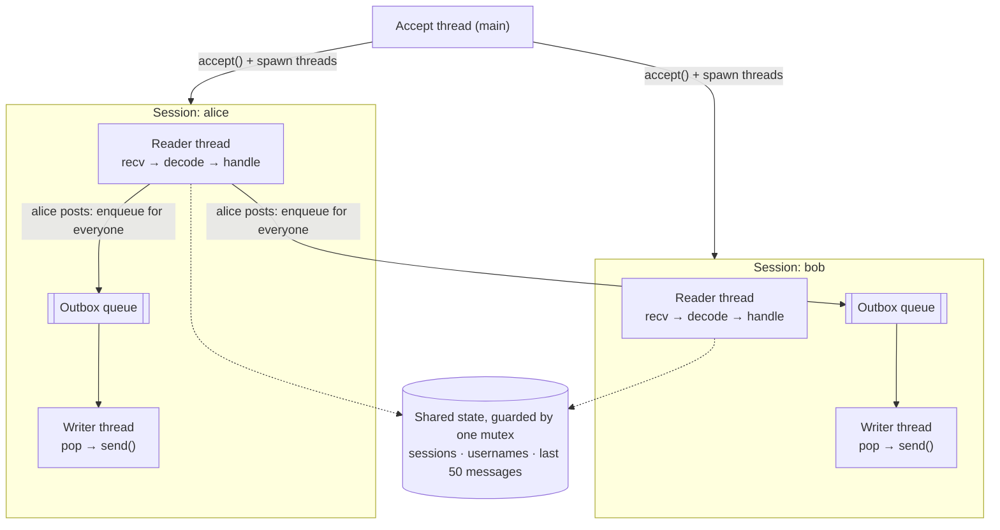
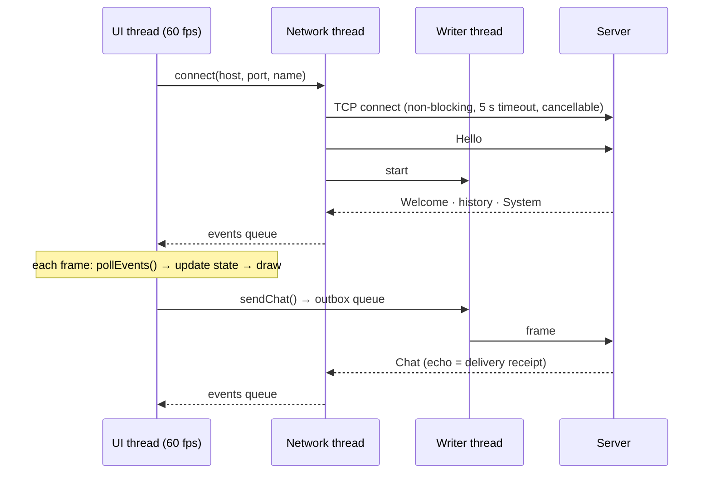

<div align="center">

# elazharyLearn

**A real-time, multi-user chat application for Windows, written from scratch in modern C++.**

A client–server project built at **ENSEM University** to learn TCP networking and multithreading in depth:
raw Winsock2 sockets, a custom binary protocol, a thread-per-connection server, and a GPU-rendered desktop client.




</div>

---

## Table of contents

- [Highlights](#highlights)
- [Screenshots](#screenshots)
- [How it works](#how-it-works)
  - [Architecture](#architecture)
  - [Server threading model](#server-threading-model)
  - [Client threading model](#client-threading-model)
  - [Wire protocol](#wire-protocol)
  - [A message's journey](#a-messages-journey)
- [Engineering decisions](#engineering-decisions)
- [Project structure](#project-structure)
- [Building](#building)
- [Running](#running)
- [Testing](#testing)
- [What I learned](#what-i-learned)
- [Roadmap](#roadmap)
- [Credits](#credits)

---

## Highlights

**For users**

- 💬 **Public channel** (`#general`) plus **private direct messages** between any two users
- 👀 **Live presence**: who's online, join/leave notices, and green/grey status dots
- ✍️ **Typing indicators** ("sara is typing…") in the channel, in DMs and in the sidebar
- 🔔 **Unread badges** per conversation, an unread counter in the window title and a flashing taskbar button when the window is in the background
- 🕘 **Message history**: newcomers see the last 50 messages of `#general`
- 🔌 **Graceful offline mode**: a clear banner, a disabled composer and one-click **Reconnect**
- 🎨 **Modern dark UI**: chat bubbles grouped by sender, colored avatars, day separators, smart auto-scroll with a *New messages* pill, per-conversation drafts, right-click *Copy text*, hover timestamps, DPI-aware layout and a dark title bar
- 💾 **Remembers you**: name, server and port are saved between sessions

**Under the hood**

- 🧵 **Thread-per-connection server** with a dedicated **reader and writer thread per client**, so a slow client can never stall the others
- 📦 **Custom length-prefixed binary protocol** with a bounds-checked decoder that rejects truncated or malformed frames
- 🔒 **No socket I/O while holding a lock**: broadcasting only enqueues pre-encoded, shared frames
- 🛑 **Clean shutdown everywhere** (Ctrl+C on the server, Sign out / close on the client), with every thread joined
- 🌐 **Dual-stack IPv4 + IPv6** listening, plus a **cancellable, time-limited connect**
- ✅ **End-to-end integration tests** that spin up a real server and real clients over loopback TCP
- 📦 **Self-contained executables** with no DLLs to ship (static MinGW runtime)

---

## Screenshots

| Sign in | Direct messages |
|:---:|:---:|
|  |  |
| Pick a display name and a server. Invalid characters can't even be typed, and errors appear inline. | Your own messages appear on the right in accent bubbles. Presence and "typing…" update live. |

| Connection lost | Server console |
|:---:|:---:|
|  | See the [sample log below](#server) |
| When the server goes away, the app explains why, disables sending and offers **Reconnect**. | Every log line shows the thread that wrote it, so the threading model is visible as it runs. |

---

## How it works

### Architecture



The networking code is split into small static libraries, so the **GUI, the terminal client and the
tests all share exactly the same client implementation**, and the server logic can run in-process
inside the test binary.

### Server threading model



| Thread | Count | Responsibility |
|---|---|---|
| **Accept** | 1 | `accept()` new sockets, start their sessions, reap finished ones |
| **Reader** | 1 per client | handshake, then `recv` → decode → handle (chat, DM, typing) |
| **Writer** | 1 per client | drain that client's outbox onto its socket |

Handling a chat message means taking the mutex, appending to history and **pushing one shared,
already-encoded frame** onto every recipient's outbox. The actual `send()` calls happen later on
each client's own writer thread, outside the lock.

### Client threading model



The UI thread **never touches a socket and never blocks**. It drains a thread-safe event queue at
the start of each frame and pushes outgoing messages onto an outbox queue. Both queues use the same
`BlockingQueue<T>` (a mutex plus a condition variable) that the server uses.

### Wire protocol

Every message is one **frame**:

```
┌──────────────────────┬──────────────────────────────────────────────┐
│ u32 length (big-end.)│ payload (≤ 64 KiB)                           │
└──────────────────────┴──────────────────────────────────────────────┘

payload = u8 version │ u8 type │ u64 timestamp_ms │ u8 flag
        │ str from │ str to │ str text │ u16 user_count │ str user…

str     = u16 length │ UTF-8 bytes
```

| Type | Direction | Meaning |
|---|---|---|
| `Hello` (1) | client → server | Handshake with the requested username |
| `SendChat` (2) | client → server | Post to `#general` |
| `SendPrivate` (3) | client → server | Direct message to `to` |
| `Typing` (4) | both | Started/stopped typing (`to` empty = `#general`) |
| `Welcome` (10) | server → client | Accepted: your name, server name and everyone online |
| `Rejected` (11) | server → client | Name taken or invalid, protocol mismatch |
| `UserJoined` / `UserLeft` (12/13) | server → client | Presence updates |
| `Chat` (14) | server → client | Channel message (`flag` = replayed from history) |
| `Private` (15) | server → client | DM, delivered to both participants |
| `System` / `Error` (16/17) | server → client | Notices such as "bob is not online" |

The decoder checks the version, type and every length against the remaining bytes, and rejects
trailing garbage. A malformed frame disconnects the peer instead of crashing the server. The tests
feed it every possible truncation of a valid frame.

### A message's journey

1. You press **Enter**. The UI thread calls `ChatClient::sendChat()`, which encodes the message and pushes it onto the outbox.
2. The client's **writer thread** pops the frame and `send()`s it.
3. On the server, your session's **reader thread** decodes it, sanitizes the text, takes the lock, appends it to history and enqueues **one shared frame** for every connected user, then releases the lock.
4. Each recipient's **writer thread** sends the frame to its own socket, independently and in parallel.
5. Each client's **network thread** receives it and posts an event. On the next frame, the UI adds a bubble, bumps unread counters, flashes the taskbar if the window is in the background and auto-scrolls if you were at the bottom.

Your own message only appears after the server's echo comes back, so what you see is exactly what everyone else received, in the same order.

---

## Engineering decisions

| Problem | Solution |
|---|---|
| One slow or stalled client blocking everyone | Per-client outbox plus writer thread. Broadcasting only enqueues |
| Unbounded memory for a client that stops reading | Outbox capped at 1,024 frames, plus a 5 s send timeout, then disconnect (backpressure) |
| Holding a lock during blocking I/O | Never done: the lock covers only in-memory state |
| Encoding the same message N times | Encoded once into a `shared_ptr<const vector<uint8_t>>` shared by all outboxes |
| Idle sockets that never say hello pinning a thread | 10 s receive timeout during the handshake |
| Stopping threads blocked in `recv()` / `accept()` | `shutdown(SD_BOTH)` / `closesocket()` from another thread, then `join()` |
| Startup races with `stop()` (e.g. Ctrl+C during startup) | `std::atomic` flags plus atomic exchange on the listen socket |
| A UI that freezes while connecting | Non-blocking `connect()` polled with `select()` in 100 ms slices, cancellable from the UI |
| Latency of small messages | `TCP_NODELAY`, and header + payload sent in a single `send()` |
| Partial reads (TCP is a byte stream) | `recvAll` loops until the whole frame has arrived |
| IPv4 vs IPv6 (`localhost` resolves to `::1`) | Dual-stack listening socket (`IPV6_V6ONLY = 0`) |
| Port hijacking by another process | `SO_EXCLUSIVEADDRUSE` |
| Impersonation (`Alice` vs `alice`) | Case-insensitive name uniqueness; names limited to `[A-Za-z0-9_.-]` |
| Privacy | DMs are routed but **their content is never logged** |
| Typing-indicator spam | Throttled to one update every 3 s. Stops after 5 s idle and expires on receivers after 6 s |

---

## Project structure

```
.
├── CMakeLists.txt
├── src/
│   ├── common/                 # shared by server, clients and tests
│   │   ├── blocking_queue.hpp  #   thread-safe queue (mutex + condition_variable)
│   │   ├── net.hpp/.cpp        #   Winsock RAII, framing, listen/connect helpers
│   │   └── protocol.hpp/.cpp   #   message types, binary encoder/decoder, validation
│   ├── server/
│   │   ├── chat_server.hpp/.cpp#   accept loop, sessions, routing, history
│   │   ├── log.hpp/.cpp        #   thread-safe colored logger (shows thread ids)
│   │   └── main.cpp            #   CLI args, Ctrl+C handling, LAN address banner
│   ├── client/
│   │   ├── chat_client.hpp/.cpp#   UI-agnostic networking (network + writer threads)
│   │   └── gui/
│   │       ├── main.cpp        #   Win32 window, Direct3D 11 swap chain, render loop
│   │       ├── chat_app.hpp/.cpp#  all screens and state (login, sidebar, chat, composer)
│   │       ├── theme.hpp/.cpp  #   colors, fonts (Segoe UI), DPI scaling
│   │       └── settings.hpp/.cpp#  persisted name/server/port
│   └── cli/main.cpp            # terminal client (great for simulating extra users)
├── tests/integration_tests.cpp # real server + real clients over loopback
├── third_party/imgui/          # Dear ImGui v1.91.5 (vendored, MIT)
└── docs/screenshots/
```

About 3,700 lines of C++, excluding Dear ImGui.

---

## Building

**Requirements:** Windows 10 or 11, CMake ≥ 3.24, Ninja, and a C++17 compiler.
The project is developed and tested with **MinGW-w64 GCC** ([WinLibs](https://winlibs.com/)), which also ships CMake and Ninja:

```powershell
winget install BrechtSanders.WinLibs.POSIX.UCRT
```

Then, from the project folder:

```powershell
cmake -S . -B build -G Ninja -DCMAKE_BUILD_TYPE=Release
cmake --build build
```

The executables are written to `build/bin/`:

| Executable | What it is |
|---|---|
| `chat_server.exe` | The chat server (console) |
| `chat_client.exe` | The desktop client (GUI) |
| `chat_cli.exe` | A minimal terminal client |
| `chat_tests.exe` | Integration tests |

Dear ImGui is vendored in `third_party/`, so the build needs no internet access. With MinGW the
executables are linked statically and run on any Windows 10+ machine without extra DLLs.
The CMake file also sets the matching flags for MSVC (`/W4 /permissive- /utf-8`).

---

## Running

### Server

```powershell
.\build\bin\chat_server.exe            # listens on port 5555
.\build\bin\chat_server.exe --port 6000
```

It prints the addresses friends on your network can use, then logs activity. Every line shows the
thread that wrote it, so you can watch the accept thread and the per-client reader threads at work:

```
  elazharyLearn Chat Server - ENSEM University
  -------------------------------------------
  Clients on this PC:      localhost:5555
  Clients on your network: 192.168.3.57:5555

15:34:44 INFO  thread 14788  Listening on port 5555 - press Ctrl+C to stop
15:34:47 INFO  thread 14788  Connection #1 from [::1]:55955
15:34:47 INFO  thread 25420  amine joined from [::1]:55955 (1 user online)
15:34:48 INFO  thread 19252  sara joined from [::1]:55956 (2 users online)
15:34:49 INFO  thread 22896  youssef joined from [::1]:55961 (3 users online)
15:34:50 CHAT  thread 25420  amine: Has anyone finished the socket lab for the networks course?
15:34:51 CHAT  thread 22896  youssef: Almost! My server now handles every client on its own thread.
15:35:01 INFO  thread 7116   salah joined from [::1]:55966 (4 users online)
15:35:06 CHAT  thread 19252  sara -> salah (direct message)
```

Press **Ctrl+C** to stop: the listener closes, every client socket is shut down and all threads are joined.

> **Chatting across PCs:** run the server on one machine, then connect from the others using the
> "Clients on your network" address. Windows Firewall will ask to allow `chat_server.exe` the first time.

### Desktop client

Launch `chat_client.exe`, choose a display name, enter the server address (default `localhost:5555`) and press **Connect**.

| Action | How |
|---|---|
| Send a message | Type and press **Enter** (or click **Send**) |
| Start a direct message | Click a person in the sidebar, or right-click their message → *Message … privately* |
| Copy a message | Right-click the bubble → *Copy text* |
| See the exact time | Hover over a bubble |
| Jump to new messages | Click the **New messages** pill |
| Leave | **Sign out** in the bottom-left corner |

Settings are saved to `%APPDATA%\elazharyLearn\client.ini`.

### Terminal client

```powershell
.\build\bin\chat_cli.exe <name> [host] [port]
```

| Command | Effect |
|---|---|
| *any text* | Post to `#general` |
| `/w <name> <message>` | Direct message |
| `/typing [name]` | Show a typing indicator in `#general`, or to `<name>` |
| `/users` | List who's online |
| `/quit` | Leave |

Running a few of these next to the GUI is the quickest way to simulate a busy classroom.

---

## Testing

```powershell
ctest --test-dir build --output-on-failure
# or directly:
.\build\bin\chat_tests.exe
```

The integration test starts a real `ChatServer` on an OS-assigned port and drives it with real
`ChatClient`s over loopback TCP:

- **Protocol**: round trip of every field (including UTF-8), and rejection of every possible truncation, trailing bytes, a wrong version and an unknown type
- **Validation**: username rules and text sanitizing
- **Session flow**: welcome and user list, history replay to latecomers, broadcast, whitespace trimming
- **Direct messages**: delivery to the recipient plus an echo to the sender, and an error for offline users
- **Typing indicators** relayed to the right people
- **Rejections**: duplicate names (case-insensitive) and invalid names
- **Presence**: `UserLeft` when a client disconnects
- **Failure path**: a refused connection is reported as an event, not a hang

```
[protocol] encode/decode round trip and malformed input
[server] join, history, broadcast, direct messages, typing, leave
[server] rejects duplicate and invalid names
[client] reports a refused connection

34 checks, 0 failed
```

The code compiles with **zero warnings** under `-Wall -Wextra -Wpedantic`.

---

## What I learned

- **TCP is a stream, not a message queue.** Framing, partial reads and `recvAll` loops are not optional.
- **Where locks go matters more than having them.** Holding a mutex across a blocking `send()` turns one slow peer into a server-wide outage. Queues decouple "deciding what to send" from "sending it".
- **Shutting down is the hardest part of multithreading.** Every thread needs a way to be woken up (`shutdown()`, `close()` on a queue, atomic flags) and an owner that `join()`s it.
- **Never trust the network.** Every length is checked, every name validated and every text sanitized before it touches shared state.
- **Responsiveness is a threading problem.** A UI stays smooth only if the UI thread never waits on the network.
- **Separation pays off.** Because `ChatClient` knows nothing about the UI, the same code powers the GUI, the CLI and the tests.

---

## Roadmap

- [ ] TLS encryption (Schannel) and password-based accounts
- [ ] Persistent history (SQLite) and multiple channels / rooms
- [ ] File and image sharing
- [ ] Replace thread-per-client with I/O completion ports (IOCP) to scale to thousands of users
- [ ] Message editing, reactions and read receipts
- [ ] Desktop notifications (Windows toast)

---

## Credits

- [Dear ImGui](https://github.com/ocornut/imgui) by Omar Cornut, the immediate-mode GUI library (MIT, vendored in `third_party/imgui`)
- Segoe UI, the Windows system font, loaded at runtime from `C:\Windows\Fonts`
- Built with Winsock2, Win32 and Direct3D 11

<div align="center">

**elazharyLearn** · ENSEM University

</div>
